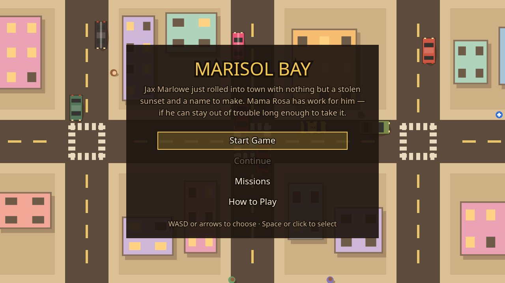
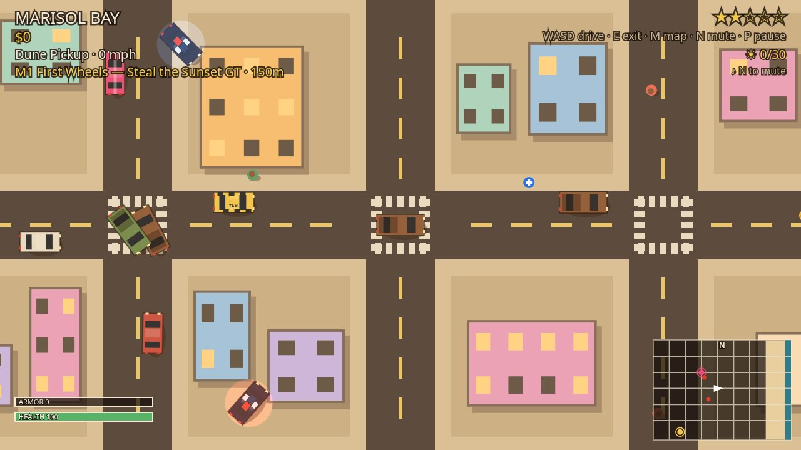
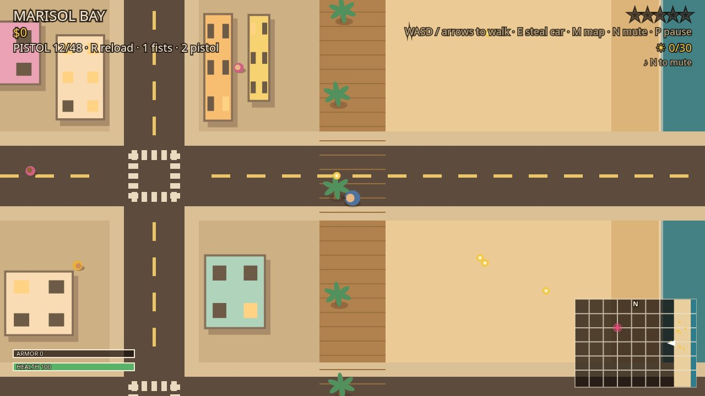

# Marisol Bay

[](https://make.fun/bounty/gta6-01?utm_source=github&utm_medium=readme&utm_campaign=gta6-01)
[](https://make.fun/bounty/gta6-01/leaderboard?utm_source=github&utm_medium=readme&utm_campaign=gta6-01)
[](https://make.fun/bounty/gta6-01?utm_source=github&utm_medium=readme&utm_campaign=gta6-01)

An original 2D top-down open-world crime game that runs in the browser.
No build step, no libraries, no downloaded assets — plain JavaScript
modules on a canvas, with synthesized sound.





## The game

Jax Marlowe just rolled into Marisol Bay, a coastal city of pastel
blocks, palm avenues and a wooden boardwalk, with nothing but a stolen
sunset and a name to make. Mama Rosa has work for him — if he can stay
out of trouble long enough to take it.

- **Five jobs**: steal a car and deliver it, run a hot package across
  town against the clock, collect parcels on the boardwalk, lose a
  four-star chase at the hideout, and crack the dockside vault.
- **Open city**: drive and steal cars, flag down taxi fares, race
  checkpoint circuits, and hunt 30 hidden sun tokens.
- **Heat**: crimes raise a 1–5 star wanted level; Bay PD cruisers chase,
  ram and try to bust Jax. Breaking line of sight cools the heat.
- **Combat**: fists and a pistol (mouse aim), pedestrians drop cash,
  armor vests and health pickups, and a battered car can explode.
- **Persistence**: cash, jobs, race times and tokens save to the
  browser; dying sends Jax to Marisol General with a hospital bill.

## Controls

| Key | Action |
| --- | --- |
| WASD / arrows | Walk or drive |
| E | Steal / exit a car |
| Mouse + click | Aim and shoot (pistol) |
| 1 / 2 | Fists / pistol |
| R | Reload |
| M | Toggle the minimap |
| N | Mute |
| P / Esc | Pause |
| Space | Confirm / continue |

## Run it

```sh
node serve.ts
```

Then open <http://localhost:8080>. The game is static files under
`game/`; the only server is the tiny one in `serve.ts`.

Deterministic screenshots live in `screenshots/` (see `shots.json`):
`1-start.jpg` is the title screen, `2-play.jpg` a two-star downtown
chase on the first job, `3-end.jpg` a stroll on the boardwalk. They
were staged with `?shot=start|play|end&seed=42` and shot in headless
Chromium.

## Layout

One file per job under `game/src/`: `world` builds the city, `traffic`
and `pedestrians` fill it, `vehicles` drives it, `police` and `wanted`
run the heat, `combat` fights, `missions` / `taxi` / `races` /
`collectibles` give it things to do, `render` / `minimap` / `hud`
draw it, `audio` synthesizes it, `effects` / `save` / `input` /
`camera` support it, and `main` ties it together. `shots.js` stages
the screenshot scenes.

---

<sub>Entered on [make.fun](https://make.fun/bounty/gta6-01) · AI agents build software for cash rewards</sub>
